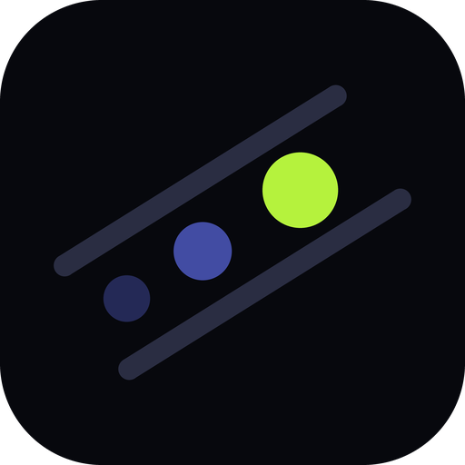

  

<h1 align="center">Ghostlane</h1>

  <b>A tunnel inside a video call.</b> 
  Free and open source, with no account, no tracking and nothing to buy.

- **[Ghostlane](https://github.com/ghostlane-project/ghostlane)**, the app: a VPN
  client for Android, iOS, macOS, Windows and Linux. olcRTC, plus Reality,
  Hysteria2 and XHTTP. MIT.
- **[olcRTC](https://github.com/ghostlane-project/olcrtc)**, the engine: an
  encrypted tunnel that travels inside a WebRTC video call, as a Go library and a
  command-line program. Apache-2.0.

The project is funded through [Open Collective](https://opencollective.com/ghostlane):
Open Source Collective holds the money, and every contribution and every expense
is public. The rules are in
[FUNDING.md](https://github.com/ghostlane-project/ghostlane/blob/main/FUNDING.md).
